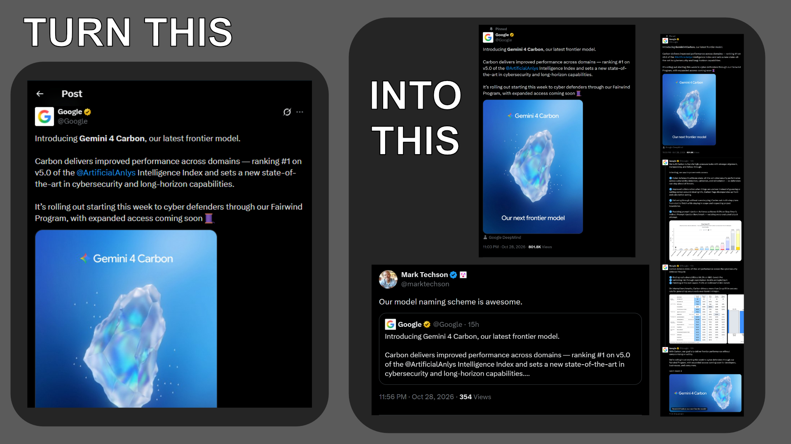

# X / Twitter Media & Thread Screenshoter



A feature-rich browser extension for Chromium (Chrome, Vivaldi, Brave, Edge, Opera) and Mozilla Firefox (Firefox, Zen Browser, Floorp) for capturing pixel-perfect, high-resolution screenshots and video recordings of X (Twitter) posts, quote tweets, conversation threads, and media.

[English](#english) | [Русский](#русский)

---

<a name="english"></a>
## English

### Overview

**X / Twitter Media & Thread Screenshoter** is designed for creators, archivists, journalists, and everyday users who need clean, high-resolution captures of tweets and conversation chains. It eliminates Twitter interface clutter (prompts, analytics, Grok, Follow/Subscribe buttons, dropdown menus) while preserving essential context such as verified badges, clean timestamps, view metrics, and media framing.

Additionally, it provides integrated video/GIF recording with automatic H.264/AAC MP4 encoding formatted for seamless playback and thumbnail generation on Telegram, Discord, and other messaging platforms.

---

### Key Features

1. **Integrated Tweet Action Button**:
   - A dedicated camera button embedded directly into tweet action bars on status pages.
   - Styled in native Twitter subtle gray (`rgb(113, 118, 123)`) to seamlessly blend with the platform's interface.
   - Dropdown menu offering context-aware capture modes.
   - Can be completely hidden via extension settings, moving all capture triggers to the popup menu.

2. **Full-Thread Conversation Capture & Slicing**:
   - Automatically navigates from the conversation root post down through the reply tree to the focal post and author follow-ups.
   - Dynamically manages Twitter virtual DOM scrolling.
   - **Interactive Post Count Selector**: For threads with 3 or more messages, an interactive slider and direct number input allow choosing the exact number of tweets to capture.
   - **Dual Thread Modes**:
     - **From start**: Captures the first N posts starting from the conversation root downwards.
     - **From end**: Captures the last N posts leading up to the current focal tweet.
   - Seamlessly stitches selected tweets into a single high-resolution vertical graphic with continuous conversation lines.

3. **Anti-Seam GIF and Video Freezing**:
   - When screenshotting threads containing animated GIFs or video loops, all playback is temporarily frozen at the current timeline frame.
   - Eliminates vertical seam displacement and timeline frame tearing across stitched screenshots.

4. **Smart Tweet Cleanup & Expansion**:
   - Automatically expands collapsed text by clicking "Show more" across both parent posts and embedded quotes.
   - Strips ephemeral UI elements: Follow buttons, Grok buttons, three-dot menus, and ad markers.
   - Cleanly positions and preserves verified badges, author handles, exact publication timestamps, and view counts.

5. **Quote & Reply Crop Slider**:
   - Interactive slider in the screenshot menu:
     - `100%`: Full quoted post.
     - `75%`: Upper three quarters of the quote.
     - `50%`: Upper half of the quote.
     - `Text`: Cropped strictly to the text body, stripping out media cards and large images.

6. **Video & GIF Recording with Telegram MP4 Support**:
   - Record videos directly from tweets with crisp rounded corners and audio.
   - **Forced Audio Unmuting (`forceAudio`)**: Twitter autoplays videos muted; the extension automatically unmutes video and restores volume when recording begins to prevent silent captures.
   - **Dual-Video Synchronization**: Synchronizes playback across both reply and parent tweet videos into a unified 60 fps canvas recording.
   - **Burn Subtitles**: Option to bake video player captions directly into the recorded video.
   - Output options:
     - **MP4 (H.264 / AAC)**: High quality, compact size, fully compatible with Telegram and Discord players. Requires local lightweight Python service (`run_server.bat`).
     - **WebM**: Pure in-browser recording without external dependencies, capturing video and audio directly via native MediaRecorder streams with injected duration metadata (`fix-webm-duration.js`).

7. **Popup Quick Actions & Modular Feature Toggles**:
   - **Quick Action Buttons**: Capture the current post, thread, or video directly from the extension toolbar popup.
   - **Modular Settings**:
     - Hide extension buttons on posts (`hideTweetButtons`).
     - Toggle forced video audio (`forceAudio`).
     - Toggle video/GIF recording in menus (`showVideoRecord`).
     - Toggle MP4 conversion via FFmpeg (`enableMp4Conversion`).
     - Toggle thread post count selector (`showThreadCount`).
     - Toggle subtitles checkbox in menu (`showSubtitlesToggle`).
     - Toggle hide action bar checkbox in menu (`showHideActionsToggle`).

8. **High-Resolution Rendering**:
   - Scalable rendering: 1x, 1.5x, 2x (Ultra HD, default), and 3x (Super HD).
   - Generates razor-sharp images even on standard 1080p monitors.

9. **Dual-Language Interface (English & Russian)**:
   - Instant language toggle in the extension popup.
   - Changes UI labels, menus, tooltips, and notification toasts immediately without page reload.

10. **Clipboard & File Export**:
    - Instant copy to clipboard as PNG (`Ctrl+V` ready for chat apps and image editors).
    - Clean, standardized file naming: `<author>-<tweet_id>-<date>.<ext>` (e.g. `vidsthatgohard-2115254180608950780-20261028.mp4`).
    - Interactive notification toast with live thumbnail preview, copy, download, and fullscreen view options.

---

### File Naming Convention

Saved media files follow a predictable, clean naming format:

- **Single post screenshot or video**:
  `<author>-<tweet_id>-<date>.<ext>`
  - Example: `vidsthatgohard-2115254180608950780-20261028.png`
  - Example: `vidsthatgohard-2115254180608950780-20261028.mp4`
- **Reply video with parent context**:
  `reply-<author>-<tweet_id>-<date>.mp4`
  - Example: `reply-vidsthatgohard-2115254180608950780-20261028.mp4`
- **Conversation thread screenshot**:
  `thread-<author>-<tweet_id>-<date>.png`
  - Example: `thread-vidsthatgohard-2115254180608950780-20261028.png`

**Format Components**:
- `<author>`: The Twitter username / handle without the `@` symbol (e.g. `vidsthatgohard`).
- `<tweet_id>`: The permanent numeric status identifier from the tweet's URL.
- `<date>`: The publication date of the tweet in `YYYYMMDD` format (extracted from the tweet's `<time>` metadata, with automatic fallback to the current save date).

---

### Installation

#### Pre-built Release Packages (Recommended)
Pre-packaged archives are located in the [releases/](releases/) folder:
- **Chrome / Edge / Brave / Chromium**: Download `twitter-screenshoter-v1.2.2-chrome.zip`, unpack into a folder, and load via `chrome://extensions` (Developer mode -> Load unpacked).
- **Firefox / Zen Browser**: Download `twitter-screenshoter-v1.2.2-firefox.xpi` and load via `about:debugging#/runtime/this-firefox` (Load Temporary Add-on...).

#### Manual Installation from Source
1. Clone or download this repository:
   ```bash
   git clone https://github.com/Sepacc/twitter-screenshoter.git
   ```

##### Chromium-based Browsers (Chrome, Vivaldi, Brave, Edge, Opera)
1. Open your browser and navigate to the extensions management page:
   - Chrome / Brave: `chrome://extensions`
   - Vivaldi: `vivaldi://extensions`
   - Edge: `edge://extensions`
2. Enable **Developer mode** (toggle in the top-right corner).
3. Click **Load unpacked**.
4. Select the `SCREENSHOTER` folder.
5. Open or refresh any post on [x.com](https://x.com).

##### Mozilla Firefox / Zen Browser (109+)
1. Open Firefox or Zen Browser and go to `about:debugging#/runtime/this-firefox`.
2. Click **Load Temporary Add-on...**.
3. Select the `manifest.json` file inside the `SCREENSHOTER` folder (or select `releases/twitter-screenshoter-v1.2.2-firefox.xpi`).
4. Open or refresh any post on [x.com](https://x.com).

---

### Configuration & Settings

Click the extension icon in your browser toolbar to open the settings popup:

- **Quick Actions**:
  - `This post`: Capture visible post.
  - `Entire thread`: Capture full conversation chain.
  - `Video / GIF`: Start media recording.
- **Language**: Switch between English and Russian.
- **Resolution Scale**: Choose between 1x, 1.5x, 2x (Ultra HD), or 3x (Super HD).
- **Video Format**:
  - `MP4 (H.264 / AAC)`: Recommended for Telegram and Discord. Requires local Python server.
  - `WebM`: Pure browser capture, no server required.
- **Feature Toggles**:
  - Hide buttons on tweets (shifts actions into popup).
  - Force audio unmuting on video recording.
  - Show/hide video recording in dropdown menus.
  - Enable/disable client MP4 conversion.
  - Show/hide thread post count selector.
  - Show/hide subtitles checkbox.
  - Show/hide action bar checkbox.
- **Auto-Copy & Auto-Download**: Toggle automatic clipboard copy and file downloading.
- **Download Subfolder**: Specify a subfolder inside your browser's default Downloads directory.

---

### Local Python Server (Optional for MP4 Conversion)

For Telegram-compatible MP4 video export and optional Python stitching:

#### Requirements
- Python 3.8+
- FFmpeg installed and accessible in system PATH

#### Quick Start (Windows)
Double-click `run_server.bat` in the `SCREENSHOTER` folder, or run:
```bash
python stitcher.py --server
```
The server will start on `http://127.0.0.1:5678`. When MP4 mode is selected in extension settings, recordings are automatically converted to H.264/AAC with faststart flags.

#### Command-Line Stitcher (CLI)
You can also stitch image slices directly from terminal:
```bash
# Stitch using Pillow
python stitcher.py --input-folder ./slices/ --output full_tweet.png --method pillow

# Stitch using FFmpeg
python stitcher.py --input-folder ./slices/ --output full_tweet.png --method ffmpeg
```

---

### Packaging Releases

To package clean extension archives for Chrome and Firefox into `releases/`:
```bash
python package.py
```
This generates:
- `releases/twitter-screenshoter-v1.2.2-chrome.zip`
- `releases/twitter-screenshoter-v1.2.2-firefox.xpi`

---

### Project Structure

```text
SCREENSHOTER/
├── manifest.json         # Manifest V3 configuration (Gecko & Chromium)
├── background.js         # Service Worker (tab capture, zoom control, downloads)
├── content.js            # Content script (DOM inspection, UI buttons, capture engine)
├── content.css           # Injected styles for buttons, menus, and toasts
├── popup.html            # Extension settings popup and quick actions markup
├── popup.js              # Settings logic, quick action triggers, translations
├── popup.css             # Settings popup styling
├── fix-webm-duration.js  # Content script WebM duration metadata injection
├── html2canvas.min.js    # Canvas rendering library
├── package.py            # Automated packaging script for releases/
├── stitcher.py           # Python HTTP microservice & CLI stitcher
├── run_server.bat        # Windows launcher script for Python server
├── requirements.txt      # Python dependencies (Pillow)
├── icons/                # Extension action icons (16, 48, 128)
├── releases/             # Standardized zip/xpi release packages
├── screenshots/          # Showcase preview banners and screenshots
├── RELEASES.md           # Version changelog
├── LICENSE               # MIT License
└── README.md             # Documentation (English and Russian)
```

---

### Third-Party Credits & Attribution

This project utilizes the following open-source resources:

- **[Feather Icons](https://feathericons.com/)** by Cole Bemis.
  - Licensed under the [MIT License](https://github.com/feathericons/feather/blob/main/LICENSE).
  - Inlined SVG icons used for interface controls, menus, toast actions, and media indicators.
- **[html2canvas](https://html2canvas.hertzen.com/)** by Niklas von Hertzen.
  - Licensed under the [MIT License](https://github.com/niklasvh/html2canvas/blob/master/LICENSE).

---

### License

This project is licensed under the **MIT License**. See the [LICENSE](LICENSE) file for complete details.

---
---

<a name="русский"></a>
## Русский

### Обзор

**X / Twitter Media & Thread Screenshoter** — это расширение для браузеров на базе Chromium (Chrome, Vivaldi, Brave, Edge, Opera) и Mozilla Firefox (Firefox, Zen Browser, Floorp), предназначенное для создания сверхчетких, аккуратных скриншотов постов, твитов с цитатами, длинных веток обсуждений и медиафайлов.

Расширение автоматически очищает интерфейс поста от визуального шума (кнопки Follow/Subscribe, Grok, меню трех точек, аналитика и рекламные метки), сохраняя при этом все важные элементы: значки верификации, авторов, точную дату и время публикации, а также счетчики просмотров.

Встроенная функция записи видео и GIF позволяет захватывать медиа вместе со звуком и субтитрами, автоматически конвертируя результат в формат MP4 (H.264/AAC), идеально подходящий для мгновенной отправки в Telegram и Discord.

---

### Основные возможности

1. **Кнопка создания скриншота в панели твита**:
   - Аккуратная кнопка с камерой, встроенная в строку действий твита (`[role="group"]`).
   - Оформлена в нативном сером цвете Twitter (`rgb(113, 118, 123)`), гармонично сочетаясь с остальными кнопками интерфейса.
   - Выпадающее меню с выбором режима захвата: текущий пост, вся ветка диалога или запись видео.
   - Возможность полностью скрыть кнопку с постов через настройки, перенеся управление в меню расширения.

2. **Захват всей ветки диалога и выбор диапазона (Thread Capture)**:
   - Автоматически находит корень цепочки диалога и прокручивает ветку от первого сообщения до целевого поста и авторских продолжений.
   - Корректно работает с виртуальным скроллингом Twitter.
   - **Интерактивный выбор числа постов**: Для веток от 3 сообщений в меню доступен слайдер и поле прямого ввода количества твитов.
   - **Два режима захвата**:
     - **С начала**: Сохраняет первые N сообщений от начала цепочки вниз.
     - **С конца**: Сохраняет последние N сообщений до текущего выбранного твита.
   - Бесшовно объединяет сообщения в одно длинное изображение высокого разрешения с непрерывными линиями диалога.

3. **Защита от разрыва кадров GIF и видео**:
   - При скриншоте длинных веток с анимированными GIF или видео все ролики временно замораживаются на текущем кадре.
   - Устраняет разрыв кадров анимаций и смещение таймлайна на границах стыковки твитов.

4. **Умная очистка и раскрытие текста**:
   - Автоматически нажимает кнопки «Показать еще» / «Show more» в основном посте и цитате, предотвращая обрезку текста.
   - Скрывает кнопки Follow, Grok, три точки и рекламные блоки.
   - Аккуратно переносит и сохраняет дату публикации, время и число просмотров.

5. **Ползунок обрезки цитаты и нижнего поста**:
   - Регулировка высоты цитируемого сообщения перед сохранением:
     - `100%`: Цитата целиком.
     - `75%`: Три четверти высоты цитаты.
     - `50%`: Верхняя половина цитаты.
     - `Текст`: Обрезка строго до текстового блока (без картинок, карточек ссылок и видео).

6. **Запись видео и GIF с поддержкой MP4 для Telegram**:
   - Запись видео с закругленными углами плеера и оригинальной звуковой дорожкой.
   - **Принудительное включение звука (`forceAudio`)**: Twitter запускает ролики без звука; расширение автоматически включает звук и выставляет громкость при старте записи.
   - **Синхронизированная запись двух видео**: Синхронное воспроизведение видео в ответе и родительском посте в едином кадре 60 FPS.
   - **Субтитры на видео**: Впечатывание включенных субтитров плеера прямо в видеофайл.
   - Форматы на выбор:
     - **MP4 (H.264 / AAC)**: Высокое качество, малый вес, идеальная поддержка видеоплеерами Telegram и Discord. Требует локального сервиса (`run_server.bat`).
     - **WebM**: Автономная запись прямо в браузере без внешних зависимостей через нативный MediaRecorder с внедрением таймкодов (`fix-webm-duration.js`).

7. **Быстрые действия и модульные настройки в попапе**:
   - **Кнопки быстрого запуска**: Захват текущего поста, треда или видео прямо из всплывающего окна расширения.
   - **Модульные переключатели**:
     - Скрыть кнопки у твитов (`hideTweetButtons`).
     - Принудительно включать звук видео (`forceAudio`).
     - Показывать запись видео и GIF в меню (`showVideoRecord`).
     - Включить конвертацию в MP4 (`enableMp4Conversion`).
     - Показывать выбор числа постов в треде (`showThreadCount`).
     - Показывать тумблер субтитров (`showSubtitlesToggle`).
     - Показывать тумблер скрытия строки действий (`showHideActionsToggle`).

8. **Масштабирование в высоком разрешении**:
   - Выбор масштаба: 1x, 1.5x, 2x (Ultra HD по умолчанию) и 3x (Super HD).
   - Четкий текст без размытия даже на экранах 1080p.

9. **Двуязычный интерфейс (Русский и Английский)**:
   - Мгновенный переключатель языка (RU / EN) в окне настроек.
   - Язык меню, подсказок и уведомлений меняется сразу без перезагрузки вкладки.

10. **Буфер обмена и экспорт файлов**:
    - Автоматическое копирование PNG в буфер обмена (`Ctrl+V` в мессенджеры и графические редакторы).
    - Четкие и структурированные имена файлов: `<автор>-<id_поста>-<дата>.<расширение>` (например, `vidsthatgohard-2115254180608950780-20261028.mp4`).
    - Всплывающее уведомление (Toast) с превью, кнопками «В буфер», «Скачать» и полноразмерным просмотром.

---

### Формат названий сохраняемых файлов

Все сохраняемые скриншоты и видеофайлы именуются по понятному и единому стандарту:

- **Скриншот или видео отдельного твита**:
  `<автор>-<id_поста>-<дата>.<расширение>`
  - Пример: `vidsthatgohard-2115254180608950780-20261028.png`
  - Пример: `vidsthatgohard-2115254180608950780-20261028.mp4`
- **Видео ответа вместе с родительским постом**:
  `reply-<автор>-<id_поста>-<дата>.mp4`
  - Пример: `reply-vidsthatgohard-2115254180608950780-20261028.mp4`
- **Скриншот всей ветки диалога**:
  `thread-<автор>-<id_поста>-<дата>.png`
  - Пример: `thread-vidsthatgohard-2115254180608950780-20261028.png`

**Значение составных частей**:
- `<автор>`: Никнейм автора без значка `@` (например, `vidsthatgohard`).
- `<id_поста>`: Постоянный числовой идентификатор твита из ссылки.
- `<дата>`: Дата публикации поста в формате `ГГГГММДД` (например, `20261028`), извлеченная из метаданных `<time>` твита (с автоматическим переключением на дату сохранения, если дата публикации не найдена).

---

### Установка в браузер

#### Готовые архивы релизов (Рекомендуется)
Собранные пакеты находятся в папке [releases/](releases/):
- **Chrome / Edge / Brave / Chromium**: Скачайте `twitter-screenshoter-v1.2.2-chrome.zip`, распакуйте в папку и загрузите через `chrome://extensions` (Режим разработчика -> Загрузить распакованное расширение).
- **Firefox / Zen Browser**: Скачайте `twitter-screenshoter-v1.2.2-firefox.xpi` и загрузите через `about:debugging#/runtime/this-firefox` (Загрузить временное дополнение...).

#### Установка из исходного кода
1. Склонируйте или скачайте этот репозиторий:
   ```bash
   git clone https://github.com/Sepacc/twitter-screenshoter.git
   ```

##### Chromium-браузеры (Chrome, Vivaldi, Brave, Edge, Opera)
1. Откройте страницу расширений в браузере:
   - Chrome / Brave: `chrome://extensions`
   - Vivaldi: `vivaldi://extensions`
   - Edge: `edge://extensions`
2. Включите **«Режим разработчика»** (Developer mode) в правом верхнем углу.
3. Нажмите **«Загрузить распакованное расширение»** (Load unpacked).
4. Выберите папку `SCREENSHOTER`.
5. Откройте или обновите страницу любого поста на [x.com](https://x.com).

##### Mozilla Firefox / Zen Browser (109+)
1. Введите в адресной строке Firefox или Zen Browser: `about:debugging#/runtime/this-firefox`
2. Нажмите кнопку **«Загрузить временное дополнение...»** (Load Temporary Add-on...).
3. Выберите файл `manifest.json` в папке `SCREENSHOTER` (или выберите архив `releases/twitter-screenshoter-v1.2.2-firefox.xpi`).
4. Откройте или обновите страницу любого поста на [x.com](https://x.com).

---

### Настройки расширения

Нажмите на иконку расширения на панели браузера:

- **Быстрые действия**:
  - `Этот пост`: Скриншот видимого поста.
  - `Вся ветка`: Скриншот всей цепочки сообщений.
  - `Видео / GIF`: Запуск записи медиа.
- **Язык**: Переключение между русским и английским языком интерфейса.
- **Масштаб разрешения**: 1x, 1.5x, 2x (Ultra HD) или 3x (Super HD).
- **Формат видео**:
  - `MP4 (H.264 / AAC)`: Оптимально для Telegram и Discord (требуется локальный сервер).
  - `WebM`: Запись внутри браузера без дополнительных программ.
- **Модульные переключатели**:
  - Скрыть кнопки у твитов (переносит запуск в меню расширения).
  - Принудительно включать звук видео при записи.
  - Показывать пункты записи видео и GIF в меню.
  - Включить конвертацию в MP4.
  - Показывать выбор числа постов в треде.
  - Показывать тумблер субтитров.
  - Показывать тумблер скрытия строки действий.
- **Авто-копирование и авто-скачивание**: Управление сохранением файла и копированием в буфер.
- **Папка для загрузок**: Название подпапки внутри стандартной папки «Загрузки».

---

### Локальный Python-сервер (Для конвертации в MP4)

Для автоматической конвертации записей в формат MP4 (H.264 / AAC) для Telegram:

#### Требования
- Python 3.8+
- Установленный FFmpeg, доступный в переменной PATH

#### Запуск (Windows)
Запустите файл `run_server.bat` в папке `SCREENSHOTER` или выполните команду:
```bash
python stitcher.py --server
```
Сервер запустится на `http://127.0.0.1:5678`. При выборе формата MP4 расширение автоматически отправляет видео на конвертацию с параметрами faststart и высоким качеством.

#### Консольный режим склейщика (CLI)
Склейку изображений из папки можно выполнять напрямую из командной строки:
```bash
# Склейка через Pillow
python stitcher.py --input-folder ./slices/ --output full_tweet.png --method pillow

# Склейка через FFmpeg
python stitcher.py --input-folder ./slices/ --output full_tweet.png --method ffmpeg
```

---

### Сборка релизов

Для сборки чистых дистрибутивов расширения в папку `releases/`:
```bash
python package.py
```
Скрипт создаст:
- `releases/twitter-screenshoter-v1.2.2-chrome.zip`
- `releases/twitter-screenshoter-v1.2.2-firefox.xpi`

---

### Структура проекта

```text
SCREENSHOTER/
├── manifest.json         # Манифест расширения Manifest V3 (Gecko и Chromium)
├── background.js         # Service Worker (захват вкладок, зум, скачивание)
├── content.js            # Content script (инспекция DOM, кнопки, движок скриншотов и видео)
├── content.css           # Стили кнопок, выпадающего меню и всплывающих уведомлений
├── popup.html            # Разметка окна настроек и быстрых действий
├── popup.js              # Логика настроек, быстрые действия, локализация
├── popup.css             # Стили окна настроек
├── fix-webm-duration.js  # Скрипт внедрения таймкодов длительности в WebM
├── html2canvas.min.js    # Вспомогательная библиотека рендеринга Canvas
├── package.py            # Автоматическая сборка релизов в releases/
├── stitcher.py           # Python HTTP-микросервис и CLI склейщик
├── run_server.bat        # Батник быстрого запуска Python-сервера на Windows
├── requirements.txt      # Зависимости Python (Pillow)
├── icons/                # Иконки расширения (16, 48, 128)
├── releases/             # Готовые zip/xpi пакеты релизов
├── screenshots/          # Демонстрационный баннер и скриншоты
├── RELEASES.md           # История изменений (Changelog)
├── LICENSE               # Текст лицензии MIT
└── README.md             # Документация (на английском и русском языках)
```

---

### Сторонние библиотеки и благодарности

В проекте используются следующие компоненты с открытым исходным кодом:

- **[Feather Icons](https://feathericons.com/)** (автор Cole Bemis).
  - Лицензия [MIT License](https://github.com/feathericons/feather/blob/main/LICENSE).
  - Встроенные SVG-иконки интерфейса, кнопок, меню, уведомлений и индикаторов плеера.
- **[html2canvas](https://html2canvas.hertzen.com/)** (автор Niklas von Hertzen).
  - Лицензия [MIT License](https://github.com/niklasvh/html2canvas/blob/master/LICENSE).

---

### Лицензия

Проект распространяется под открытой лицензией **MIT**. Подробности в файле [LICENSE](LICENSE).
