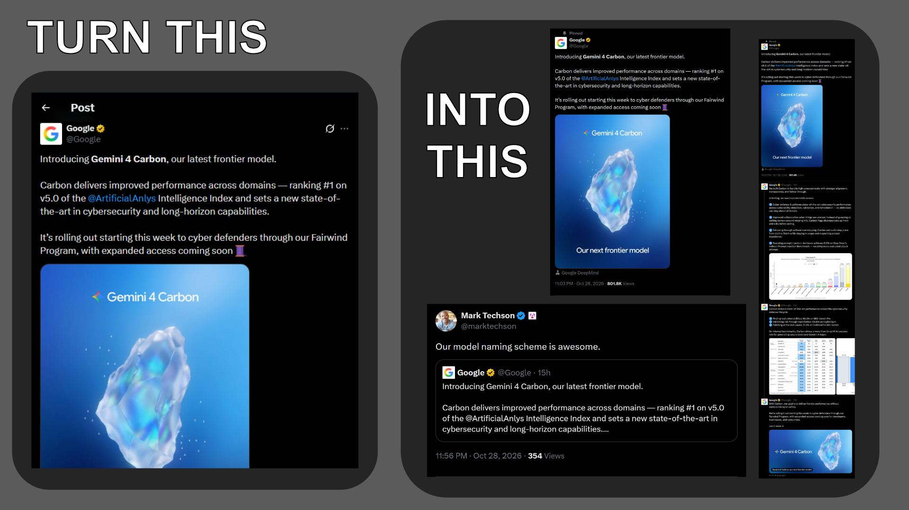

# X / Twitter Media & Thread Screenshoter



A feature-rich browser extension for Chromium (Chrome, Vivaldi, Brave, Edge) and Mozilla Firefox for capturing pixel-perfect, high-resolution screenshots and video recordings of X (Twitter) posts, quote tweets, conversation threads, and media.

[English](#english) | [Русский](#русский)

---

<a name="english"></a>
## English

### Overview

**X / Twitter Media & Thread Screenshoter** is designed for creators, archivists, journalists, and everyday users who need clean, high-resolution captures of tweets and conversation chains. It eliminates Twitter interface clutter (prompts, analytics, Grok, Follow/Subscribe buttons, dropdown menus) while preserving essential context such as verified badges, clean timestamps, view metrics, and media framing.

Additionally, it provides integrated video/GIF recording with automatic H.264/AAC MP4 encoding formatted for seamless playback and thumbnail generation on Telegram, Discord, and other messaging platforms.

---

### Key Features

1. **Integrated Tweet Action Button**:
   - A dedicated camera button embedded directly into tweet action bars on status pages.
   - Highlights with an accent indicator on Quote Tweets.
   - Dropdown menu offering context-aware capture modes.

2. **Full-Thread Conversation Capture**:
   - Automatically navigates from the conversation root post down through the reply tree to the focal post and author follow-ups.
   - Dynamically manages Twitter virtual DOM scrolling.
   - Seamlessly stitches all tweets into a single high-resolution vertical graphic with continuous conversation lines.

3. **Smart Tweet Cleanup & Expansion**:
   - Automatically expands collapsed text by clicking "Show more" across both parent posts and embedded quotes.
   - Strips ephemeral UI elements: Follow buttons, Grok buttons, three-dot menus, and ad markers.
   - Cleanly positions and preserves verified badges, author handles, exact publication timestamps, and view counts.

4. **Quote & Reply Crop Slider**:
   - Interactive slider in the screenshot menu:
     - `100%`: Full quoted post.
     - `75%`: Upper three quarters of the quote.
     - `50%`: Upper half of the quote.
     - `Text`: Cropped strictly to the text body, stripping out media cards and large images.

5. **Video & GIF Recording with Telegram MP4 Support**:
   - Record videos directly from tweets with crisp rounded corners and audio.
   - Support for burning video subtitles / closed captions into the output.
   - Dual capture modes: record reply post alone, or reply combined with the parent post into a single synchronized video frame.
   - Output options:
     - **MP4 (H.264 / AAC)**: High quality, compact size, fully compatible with Telegram and Discord players. Requires local lightweight Python service (`run_server.bat`).
     - **WebM**: Pure in-browser recording without external dependencies, capturing video and audio directly via native MediaRecorder streams.

6. **Action Bar Visibility Toggle**:
   - Option to hide the reply, retweet, like, and bookmark row for minimal aesthetic captures.

7. **High-Resolution Rendering**:
   - Scalable rendering: 1x, 1.5x, 2x (Ultra HD, default), and 3x (Super HD).
   - Generates razor-sharp images even on standard 1080p monitors.

8. **Dual-Language Interface (English & Russian)**:
   - Instant language toggle in the extension popup.
   - Changes UI labels, menus, tooltips, and notification toasts immediately without page reload.

9. **Clipboard & File Export**:
   - Instant copy to clipboard as PNG (`Ctrl+V` ready for chat apps and image editors).
   - Clean, standardized file naming: `<author>-<tweet_id>-<date>.<ext>` (e.g. `vidsthatgohard-2115254180608950780-20261028.mp4`).
   - Interactive notification toast with live thumbnail preview, copy, download, and fullscreen view options.

---

### File Naming Convention

Saved media files follow a predictable, clean naming format:

- **Single post screenshot or video**:
  `<author>-<tweet_id>-<date>.<ext>`
  - Example: `vidsthatgohard-2115254180608950780-20261028.png`
  - Example: `vidsthatgohard-2115254180608950780-20261028.mp4`
- **Reply video with parent context**:
  `reply-<author>-<tweet_id>-<date>.mp4`
  - Example: `reply-vidsthatgohard-2115254180608950780-20261028.mp4`
- **Conversation thread screenshot**:
  `thread-<author>-<tweet_id>-<date>.png`
  - Example: `thread-vidsthatgohard-2115254180608950780-20261028.png`

**Format Components**:
- `<author>`: The Twitter username / handle without the `@` symbol (e.g. `vidsthatgohard`).
- `<tweet_id>`: The permanent numeric status identifier from the tweet's URL.
- `<date>`: The publication date of the tweet in `YYYYMMDD` format (extracted from the tweet's `<time>` metadata, with automatic fallback to the current save date).

---

### Installation

1. Clone or download this repository:
   ```bash
   git clone https://github.com/your-username/twitter-screenshoter.git
   ```

#### Chromium-based Browsers (Chrome, Vivaldi, Brave, Edge)
1. Open your browser and navigate to the extensions management page:
   - Chrome / Brave: `chrome://extensions`
   - Vivaldi: `vivaldi://extensions`
   - Edge: `edge://extensions`
2. Enable **Developer mode** (toggle in the top-right corner).
3. Click **Load unpacked** (or drag and drop the folder).
4. Select the `SCREENSHOTER` folder.
5. Open or refresh any post on [x.com](https://x.com).

#### Mozilla Firefox (121+)
1. Open Firefox and navigate to `about:debugging#/runtime/this-firefox` in the address bar.
2. Click **Load Temporary Add-on...**
3. Select the `manifest.json` file inside the `SCREENSHOTER` folder.
4. Open or refresh any post on [x.com](https://x.com).

---

### Configuration & Settings

Click the extension icon in your browser toolbar to open the settings popup:

- **Language**: Switch between English and Russian.
- **Resolution Scale**: Choose between 1x, 1.5x, 2x (Ultra HD), or 3x (Super HD).
- **Video Format**:
  - `MP4 (H.264 / AAC)`: Recommended for Telegram and Discord. Requires local Python server.
  - `WebM`: Pure browser capture, no server required.
- **Button Visibility**: Show on all posts or only on quote tweets.
- **Hide Action Bar**: Hide replies, retweets, likes, and bookmarks from screenshots.
- **Burn Subtitles**: Automatically overlay video player captions onto recorded video.
- **Auto-Copy & Auto-Download**: Toggle automatic clipboard copy and file downloading.
- **Download Subfolder**: Specify a subfolder inside your browser's default Downloads directory.

---

### Local Python Server (Optional for MP4 Conversion)

For Telegram-compatible MP4 video export and optional Python stitching:

#### Requirements
- Python 3.8+
- FFmpeg installed and accessible in system PATH

#### Quick Start (Windows)
Double-click `run_server.bat` in the `SCREENSHOTER` folder, or run:
```bash
python stitcher.py --server
```
The server will start on `http://127.0.0.1:5678`. When MP4 mode is selected in extension settings, recordings are automatically converted to H.264/AAC with faststart flags.

#### Command-Line Stitcher (CLI)
You can also stitch image slices directly from terminal:
```bash
# Stitch using Pillow
python stitcher.py --input-folder ./slices/ --output full_tweet.png --method pillow

# Stitch using FFmpeg
python stitcher.py --input-folder ./slices/ --output full_tweet.png --method ffmpeg
```

---

### Project Structure

```text
SCREENSHOTER/
├── manifest.json         # Manifest V3 configuration
├── background.js         # Service Worker (tab capture, zoom control, downloads)
├── content.js            # Content script (DOM inspection, UI buttons, capture engine)
├── content.css           # Injected styles for buttons, menus, and toasts
├── popup.html            # Extension settings popup markup
├── popup.js              # Settings logic, translations, and Python server ping
├── popup.css             # Settings popup styling
├── stitcher.py           # Python HTTP microservice & CLI stitcher
├── run_server.bat        # Windows launcher script for Python server
├── requirements.txt      # Python dependencies (Pillow)
├── html2canvas.min.js    # Canvas rendering fallback library
├── feather/              # Bundled Feather SVG icon set
├── icons/                # Extension action icons (16, 48, 128)
├── screenshots/          # Showcase preview banners and screenshots
├── LICENSE               # MIT License
└── README.md             # Documentation (English and Russian)
```

---

### Third-Party Credits & Attribution

This project utilizes the following open-source resources:

- **[Feather Icons](https://feathericons.com/)** by Cole Bemis.
  - Licensed under the [MIT License](https://github.com/feathericons/feather/blob/main/LICENSE).
  - Used for interface controls, menus, toast actions, and media indicators.
- **[html2canvas](https://html2canvas.hertzen.com/)** by Niklas von Hertzen.
  - Licensed under the [MIT License](https://github.com/niklasvh/html2canvas/blob/master/LICENSE).

---

### License

This project is licensed under the **MIT License**. See the [LICENSE](LICENSE) file for complete details.

---
---

<a name="русский"></a>
## Русский

### Обзор

**X / Twitter Media & Thread Screenshoter** — это расширение для браузеров на базе Chromium (Chrome, Vivaldi, Brave, Edge) и Mozilla Firefox, предназначенное для создания сверхчетких, аккуратных скриншотов постов, твитов с цитатами, длинных веток обсуждений и медиафайлов.

Расширение автоматически очищает интерфейс поста от визуального шума (кнопки Follow/Subscribe, Grok, меню трех точек, аналитика и рекламные метки), сохраняя при этом все важные элементы: значки верификации, авторов, точную дату и время публикации, а также счетчики просмотров.

Встроенная функция записи видео и GIF позволяет захватывать медиа вместе со звуком и субтитрами, автоматически конвертируя результат в формат MP4 (H.264/AAC), идеально подходящий для мгновенной отправки в Telegram и Discord.

---

### Основные возможности

1. **Кнопка создания скриншота в панели твита**:
   - Аккуратная кнопка с камерой, встроенная в строку действий твита (`[role="group"]`).
   - Для постов с цитатами кнопка подсвечивается акцентным цветом с индикатором-точкой.
   - Выпадающее меню с выбором режима захвата: текущий пост, вся ветка диалога или запись видео.

2. **Захват всей ветки диалога (Thread Capture)**:
   - Автоматически находит корень цепочки диалога и прокручивает ветку от первого сообщения до целевого поста и авторских продолжений.
   - Корректно работает с виртуальным скроллингом Twitter.
   - Бесшовно объединяет все сообщения цепочки в одно длинное изображение высокого разрешения с непрерывными линиями диалога.

3. **Умная очистка и раскрытие текста**:
   - Автоматически нажимает кнопки «Показать еще» / «Show more» в основном посте и цитате, предотвращая обрезку текста.
   - Скрывает кнопки Follow, Grok, три точки и рекламные блоки.
   - Аккуратно переносит и сохраняет дату публикации, время и число просмотров.

4. **Ползунок обрезки цитаты и нижнего поста**:
   - Регулировка высоты цитируемого сообщения перед сохранением:
     - `100%`: Цитата целиком.
     - `75%`: Три четверти высоты цитаты.
     - `50%`: Верхняя половина цитаты.
     - `Текст`: Обрезка строго до текстового блока (без картинок, карточек ссылок и видео).

5. **Запись видео и GIF с поддержкой MP4 для Telegram**:
   - Запись видео с закругленными углами плеера и оригинальной звуковой дорожкой.
   - Впечатывание субтитров плеера прямо в видеофайл.
   - Запись ответа отдельно либо вместе с родительским постом в едином видеокадре.
   - Форматы на выбор:
     - **MP4 (H.264 / AAC)**: Высокое качество, малый вес, идеальная поддержка видеоплеерами Telegram и Discord. Требует локального сервиса (`run_server.bat`).
     - **WebM**: Автономная запись прямо в браузере без внешних зависимостей с прямой передачей видео и звука через чистый MediaRecorder.

6. **Скрытие строки действий**:
   - Возможность скрыть кнопки лайков, ретвитов, закладок и ответов для эстетичных скриншотов.

7. **Масштабирование в высоком разрешении**:
   - Выбор масштаба: 1x, 1.5x, 2x (Ultra HD по умолчанию) и 3x (Super HD).
   - Четкий текст без размытия даже на экранах 1080p.

8. **Двуязычный интерфейс (Русский и Английский)**:
   - Мгновенный переключатель языка (RU / EN) в окне настроек.
   - Язык меню, подсказок и уведомлений меняется сразу без перезагрузки вкладки.

9. **Буфер обмена и экспорт файлов**:
   - Автоматическое копирование PNG в буфер обмена (`Ctrl+V` в мессенджеры и графические редакторы).
   - Четкие и структурированные имена файлов: `<автор>-<id_поста>-<дата>.<расширение>` (например, `vidsthatgohard-2115254180608950780-20261028.mp4`).
   - Всплывающее уведомление (Toast) с превью, кнопками «В буфер», «Скачать» и полноразмерным просмотром.

---

### Формат названий сохраняемых файлов

Все сохраняемые скриншоты и видеофайлы именуются по понятному и единому стандарту:

- **Скриншот или видео отдельного твита**:
  `<автор>-<id_поста>-<дата>.<расширение>`
  - Пример: `vidsthatgohard-2115254180608950780-20261028.png`
  - Пример: `vidsthatgohard-2115254180608950780-20261028.mp4`
- **Видео ответа вместе с родительским постом**:
  `reply-<автор>-<id_поста>-<дата>.mp4`
  - Пример: `reply-vidsthatgohard-2115254180608950780-20261028.mp4`
- **Скриншот всей ветки диалога**:
  `thread-<автор>-<id_поста>-<дата>.png`
  - Пример: `thread-vidsthatgohard-2115254180608950780-20261028.png`

**Значение составных частей**:
- `<автор>`: Никнейм автора без значка `@` (например, `vidsthatgohard`).
- `<id_поста>`: Постоянный числовой идентификатор твита из ссылки.
- `<дата>`: Дата публикации поста в формате `ГГГГММДД` (например, `20261028`), извлеченная из метаданных `<time>` твита (с автоматическим переключением на дату сохранения, если дата публикации не найдена).

---

### Установка в браузер

1. Склонируйте или скачайте этот репозиторий:
   ```bash
   git clone https://github.com/your-username/twitter-screenshoter.git
   ```

#### Chromium-браузеры (Chrome, Vivaldi, Brave, Edge, Opera)
1. Откройте страницу расширений в браузере:
   - Chrome / Brave: `chrome://extensions`
   - Vivaldi: `vivaldi://extensions`
   - Edge: `edge://extensions`
2. Включите **«Режим разработчика»** (Developer mode) в правом верхнем углу.
3. Нажмите **«Загрузить распакованное расширение»** (Load unpacked).
4. Выберите папку `SCREENSHOTER`.
5. Откройте или обновите страницу любого поста на [x.com](https://x.com).

#### Mozilla Firefox (121+)
1. Введите в адресной строке Firefox: `about:debugging#/runtime/this-firefox`
2. Нажмите кнопку **«Загрузить временное дополнение...»** (Load Temporary Add-on...)
3. Выберите файл `manifest.json` в папке `SCREENSHOTER`.
4. Откройте или обновите страницу любого поста на [x.com](https://x.com).

---

### Настройки расширения

Нажмите на иконку расширения на панели браузера:

- **Язык**: Переключение между русским и английским языком интерфейса.
- **Масштаб разрешения**: 1x, 1.5x, 2x (Ultra HD) или 3x (Super HD).
- **Формат видео**:
  - `MP4 (H.264 / AAC)`: Оптимально для Telegram и Discord (требуется локальный сервер).
  - `WebM`: Запись внутри браузера без дополнительных программ.
- **Отображение кнопки**: На всех твитах или только на твитах-цитатах.
- **Скрыть кнопки действий**: Скрывает строку с лайками, ретвитами и закладками.
- **Субтитры на видео**: Впечатывать включенные субтитры плеера в файл.
- **Авто-копирование и авто-скачивание**: Управление сохранением файла и копированием в буфер.
- **Папка для загрузок**: Название подпапки внутри стандартной папки «Загрузки».

---

### Локальный Python-сервер (Для конвертации в MP4)

Для автоматической конвертации записей в формат MP4 (H.264 / AAC) для Telegram:

#### Требования
- Python 3.8+
- Установленный FFmpeg, доступный в переменной PATH

#### Запуск (Windows)
Запустите файл `run_server.bat` в папке `SCREENSHOTER` или выполните команду:
```bash
python stitcher.py --server
```
Сервер запустится на `http://127.0.0.1:5678`. При выборе формата MP4 расширение автоматически отправляет видео на конвертацию с параметрами faststart и высоким качеством.

#### Консольный режим склейщика (CLI)
Склейку изображений из папки можно выполнять напрямую из командной строки:
```bash
# Склейка через Pillow
python stitcher.py --input-folder ./slices/ --output full_tweet.png --method pillow

# Склейка через FFmpeg
python stitcher.py --input-folder ./slices/ --output full_tweet.png --method ffmpeg
```

---

### Структура проекта

```text
SCREENSHOTER/
├── manifest.json         # Манифест расширения Manifest V3
├── background.js         # Service Worker (захват вкладок, управление зумом, скачивание)
├── content.js            # Content script (инспекция DOM, кнопки, движок скриншотов и видео)
├── content.css           # Стили кнопок, выпадающего меню и всплывающих уведомлений
├── popup.html            # Разметка окна настроек
├── popup.js              # Логика настроек, локализация и проверка статуса Python
├── popup.css             # Стили окна настроек
├── stitcher.py           # Python HTTP-микросервис и CLI склейщик
├── run_server.bat        # Батник быстрого запуска Python-сервера на Windows
├── requirements.txt      # Зависимости Python (Pillow)
├── html2canvas.min.js    # Вспомогательная библиотека рендеринга Canvas
├── feather/              # Набор SVG иконок Feather Icons
├── icons/                # Иконки расширения (16, 48, 128)
├── screenshots/          # Демонстрационный баннер и скриншоты
├── LICENSE               # Текст лицензии MIT
└── README.md             # Документация (на английском и русском языках)
```

---

### Сторонние библиотеки и благодарности

В проекте используются следующие компоненты с открытым исходным кодом:

- **[Feather Icons](https://feathericons.com/)** (автор Cole Bemis).
  - Лицензия [MIT License](https://github.com/feathericons/feather/blob/main/LICENSE).
  - Иконки интерфейса, кнопок, меню, уведомлений и индикаторов плеера.
- **[html2canvas](https://html2canvas.hertzen.com/)** (автор Niklas von Hertzen).
  - Лицензия [MIT License](https://github.com/niklasvh/html2canvas/blob/master/LICENSE).

---

### Лицензия

Проект распространяется под открытой лицензией **MIT**. Подробности в файле [LICENSE](LICENSE).
